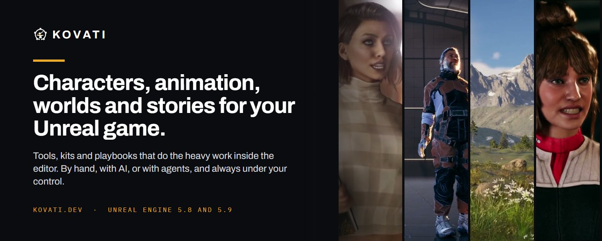
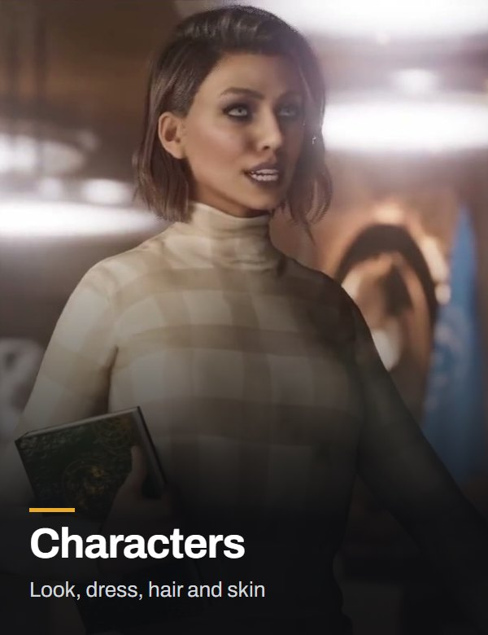
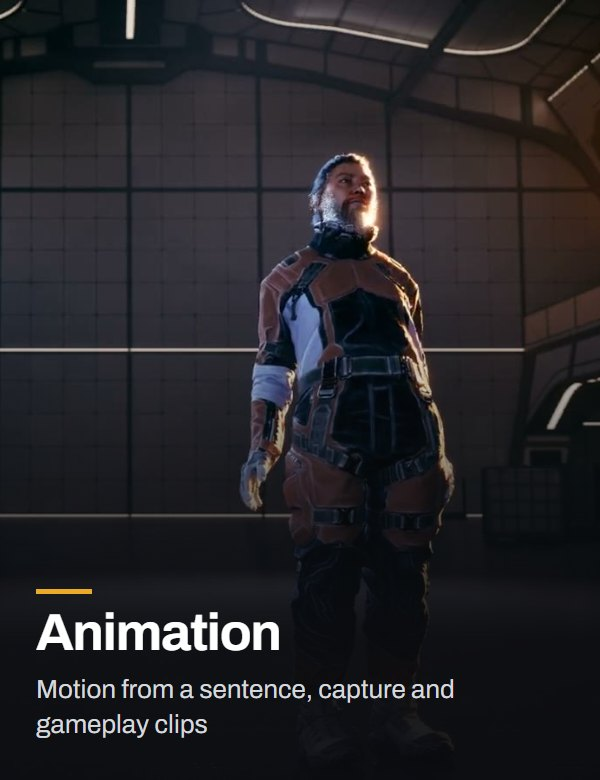
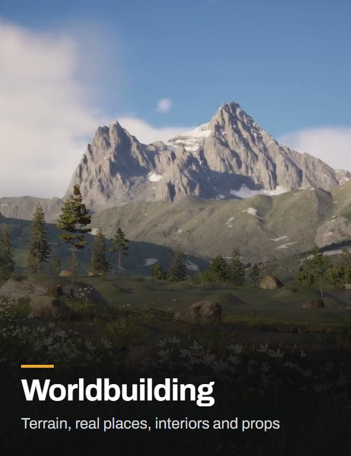
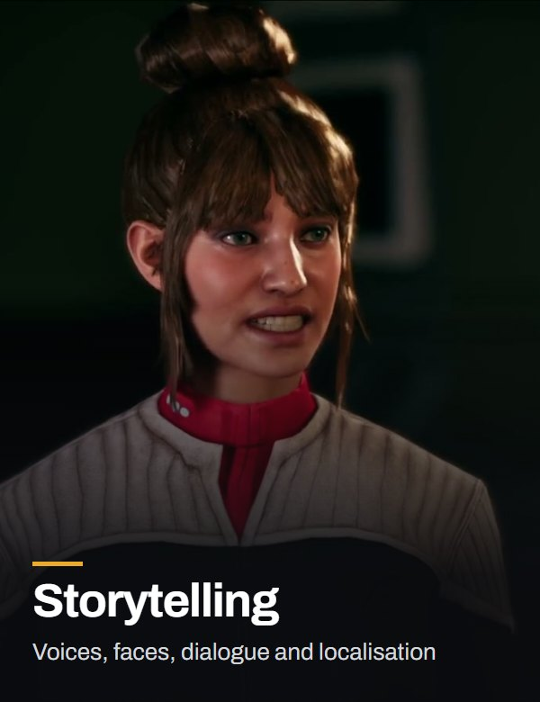
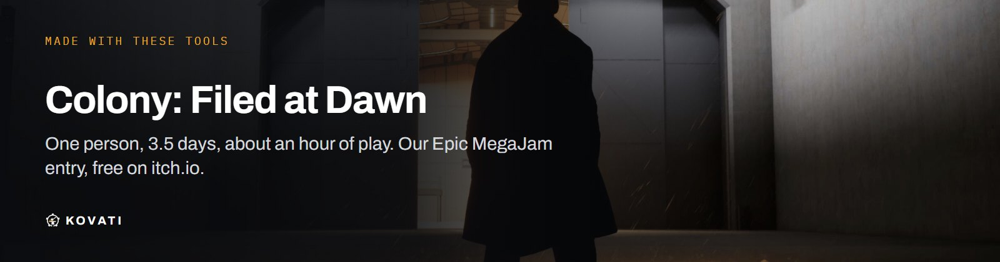
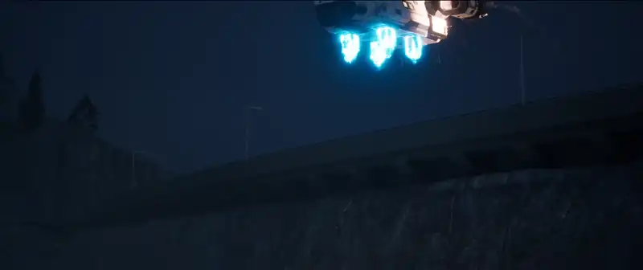

  

<h1 align="center">Kovati</h1>

<b>Production tools for Unreal games.</b> 
Characters, animation, worlds and stories, made inside the editor. 
Every step works by hand. AI and agents are there when you want them.

  <a href="https://kovati.dev"><b>Site</b></a> ·
  <a href="https://kovati.dev/download/"><b>Start free</b></a> ·
  <a href="https://docs.kovati.dev">Documentation</a> ·
  <a href="https://youtu.be/mQxh0G-KyII">Trailer</a> ·
  <a href="https://kovati.dev/discord">Discord</a> ·
  <a href="https://x.com/kovatidev">X</a>

---

## Four things your game needs

<table>
  <tr>
    <td width="25%"></td>
    <td width="25%"></td>
    <td width="25%"></td>
    <td width="25%"></td>
  </tr>
</table>

Each track is one result and a set of tools for it. You choose which tools to use, and how: by hand in their own panels, with AI doing a step, or with an agent driving the same tools you would.

## Made for a real game

  

Every tool here started as a problem in our own game. In November 2026 we entered the Epic MegaJam with them and shipped **Colony: Filed at Dawn**: one person, 3.5 days, about an hour of play, with 66 voiced dialogues.

  

  <a href="https://kovatidev.itch.io/colony-filed-at-dawn"><b>Play it free on itch.io</b></a> ·
  <a href="https://youtu.be/mQxh0G-KyII">Watch the trailer (1 min)</a> ·
  <a href="https://youtu.be/bGjJnmHoOHw">Watch the devlog (16 min)</a>

## The tools

| Track | Tool | What you get | Source |
|---|---|---|---|
| **Characters** | [MeshForge Garment](https://kovati.dev/tools/meshforge/) | One outfit, fitted to every body | Paid · [agent toolset](https://github.com/AutomationForgeHQ/MeshForgeGarmentToolset) |
| | [SkinForge](https://kovati.dev/tools/skinforge/) | Scars, tattoos and marks, exactly where you want them | Paid, with a free Lite tier · [agent toolset](https://github.com/AutomationForgeHQ/SkinForgeToolset) |
| | [MeshWeightRemap](https://github.com/AutomationForgeHQ/MeshWeightRemap) | Any garment follows any body | [Open](https://github.com/AutomationForgeHQ/MeshWeightRemap) |
| **Animation** | [MotionForge](https://kovati.dev/tools/motionforge/) | Type a motion. Watch your character do it | [Open](https://github.com/AutomationForgeHQ/MotionForge) |
| | [MontageForge](https://kovati.dev/tools/montageforge/) | From a clip to a move your gameplay can play | [Open](https://github.com/AutomationForgeHQ/MontageForge) |
| **Worldbuilding** | [TerrainForge](https://kovati.dev/tools/terrainforge/) | Real or imagined terrain, built in your level | Paid, with a free Lite tier · [agent toolset](https://github.com/AutomationForgeHQ/TerrainForgeToolset) |
| | [MeshForge](https://kovati.dev/tools/meshforge/) | Props, gear and outfits, made in Unreal | [Open](https://github.com/AutomationForgeHQ/MeshForge) |
| | [SurfaceForge](https://kovati.dev/tools/surfaceforge/) | Say the surface. Keep the one you like | [Open](https://github.com/AutomationForgeHQ/SurfaceForge) |
| **Storytelling** | [SpeechForge](https://kovati.dev/tools/speechforge/) | Every line in your game, spoken | [Open](https://github.com/AutomationForgeHQ/SpeechForge) |
| | [FaceForge](https://kovati.dev/tools/faceforge/) | A face that moves with every line | [Open](https://github.com/AutomationForgeHQ/FaceForge) |
| | [PerformanceForge](https://kovati.dev/tools/performanceforge/) | Act the scene yourself, and your character plays it | Paid · [agent toolset](https://github.com/AutomationForgeHQ/PerformanceForgeToolset) |
| **For teams** | [Automation Forge](https://github.com/AutomationForgeHQ/automation-forge) | Run your tools as one pipeline, with every result on record | [Agent toolset](https://github.com/AutomationForgeHQ/AutomationForgeToolset) |

What each one does today, and where its edges are: [docs.kovati.dev](https://docs.kovati.dev).

## Start free

1. **[Download the Kovati Hub](https://kovati.dev/download/)**. It is one free app that installs and updates every tool you own, for Unreal Engine 5.8.
2. **Sign in** with a free account.
3. **Install a tool** with one click, and open it from the editor's **Tools** menu.

## Open source

- **28 of our 43 plugins are open source** under Apache-2.0, one repository each in this organisation.
- **150 public releases** since August 2026, every one with checksums, on [`releases`](https://github.com/AutomationForgeHQ/releases).
- **Every tool works with agents.** Each one has a toolset that gives an agent the same operations a person has in the panel, built on Unreal's own Model Context Protocol support. The toolsets are open, including the ones for our paid tools.

Paid tools are sold on [kovati.dev](https://kovati.dev) and delivered through the Hub. How each plugin ended up open or paid: [DISTRIBUTION.md](https://github.com/AutomationForgeHQ/automation-forge/blob/main/docs/DISTRIBUTION.md).

## Repositories

- [`automation-forge`](https://github.com/AutomationForgeHQ/automation-forge): the Kovati Hub, the `forge` command line and the release manifest. Start here if you want to see how installs work.
- [`releases`](https://github.com/AutomationForgeHQ/releases): every plugin build, per engine version.
- [`kovati-docs`](https://github.com/AutomationForgeHQ/kovati-docs): the source of [docs.kovati.dev](https://docs.kovati.dev).
- One repository per open plugin. Browse them in this organisation, or by tool in the table above.
- [`kovati-companion`](https://github.com/AutomationForgeHQ/kovati-companion): the recording app for Kovati Studio, our video workspace.

## Who is behind it

**Kovati** is built by Bojan Andrejek and owned by **MetaWorx LLC**, which holds the IP and runs the infrastructure behind the account and the cloud services. The tools are made and used daily in **Colony: New Origins**, our own Unreal Engine game.

The thinking behind the tools, for those who want it: [PlayableOps in short](https://github.com/AutomationForgeHQ/automation-forge/blob/main/docs/PLAYABLE-OPS.md), the [manifesto](https://github.com/AutomationForgeHQ/automation-forge/blob/main/docs/MANIFESTO.md) and the [whitepaper](https://kovati.dev/whitepaper).

---

Unreal Engine is a trademark of Epic Games, Inc. Kovati is an independent product and is not endorsed by Epic Games, Inc.

Questions: [bojan@kovati.dev](mailto:bojan@kovati.dev)
